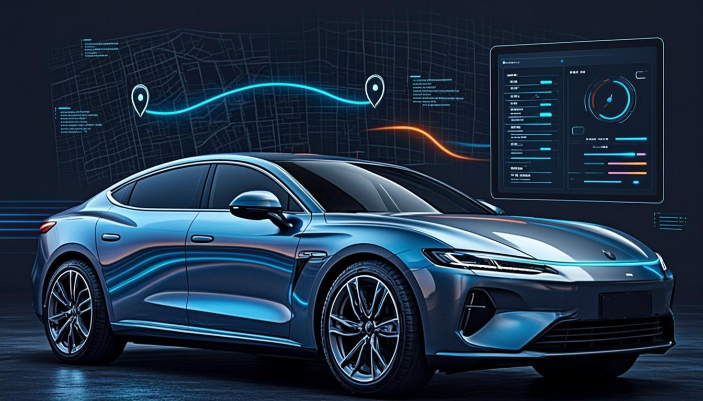
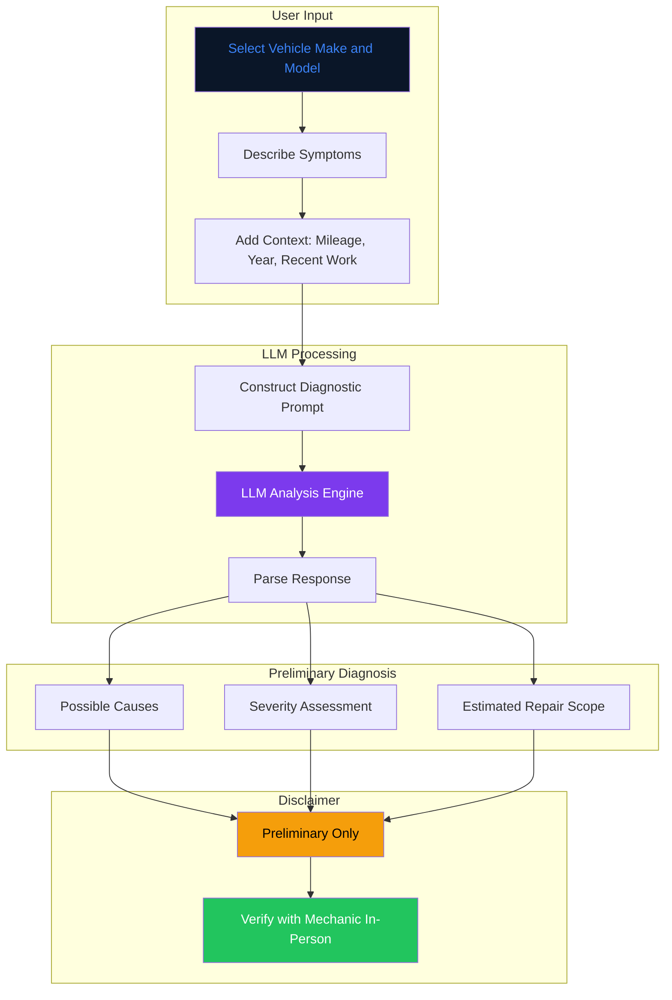
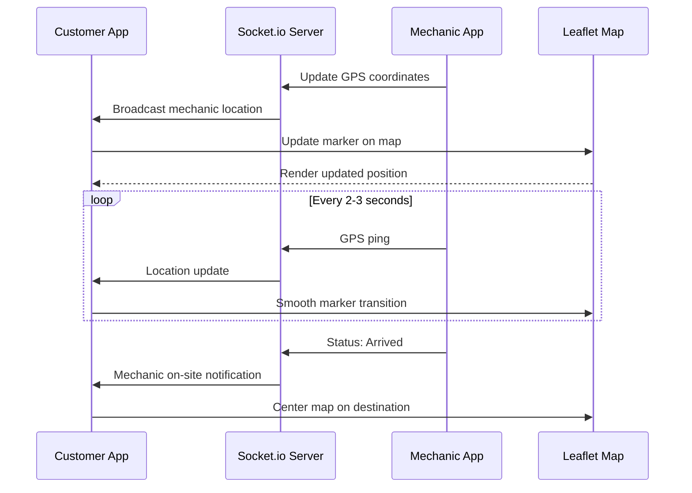
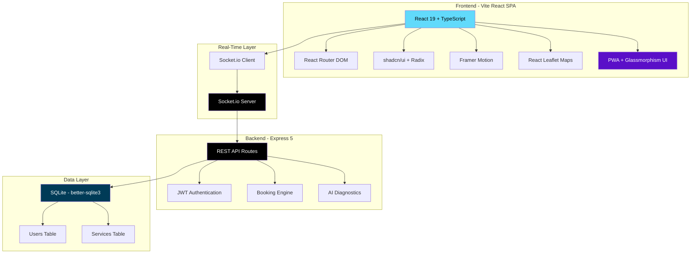

<!-- CAPSULE-RENDER HEADER -->


<!-- TYPING SVG -->
<div align="center">
  <a href="https://git.io/typing-svg">
    
  </a>
</div>

<br/>

<!-- BADGES -->
<div align="center">

[](https://nextjs.org/)
[](https://www.typescriptlang.org/)
[](https://react.dev/)
[](https://tailwindcss.com/)
[](./LICENSE)

</div>

---

## Overview

**Oke Mekanik** is a mobile mechanic service platform built with Next.js. Customers can book mechanics to come to their location, receive AI-powered preliminary vehicle diagnostics, track mechanic arrival in real-time, and manage service history — all from a modern web interface.

## Visual Architecture

### Service Booking Flow

```mermaid
flowchart LR
    subgraph Request["Request"]
        A["Open App"] --> B["Describe Vehicle Issue"]
        B --> C["Set Location"]
        C --> D["Submit Request"]
    end

    subgraph Match["Match"]
        D --> E["Find Nearby Mechanics"]
        E --> F["Mechanic Accepts"]
        F --> G["ETA Calculated"]
    end

    subgraph Track["Track"]
        G --> H["Live GPS Tracking"]
        H --> I["Mechanic En Route"]
        I --> J["Mechanic Arrives"]
    end

    subgraph Complete["Complete"]
        J --> K["Service Performed"]
        K --> L["Payment Processed"]
        L --> M["Rate and Review"]
    end

    style A fill:#0a1628,color:#3b82f6
    style F fill:#143d5e,color:#f59e0b
    style H fill:#0d2b4a,color:#3b82f6
    style M fill:#22c55e,color:#fff
```



### AI Diagnostics Pipeline



### Real-Time GPS Tracking



### Full Stack Architecture



> **Published**: This package is published to npm as `oke-mekanik-mobile-service` v7.0.0. The AI diagnostics feature provides preliminary assessments only — always verify with an in-person mechanic inspection.

---

## Features

- **Service Booking** — Schedule mobile mechanic visits with location, vehicle info, and issue description
- **AI Preliminary Diagnostics** — Describe your vehicle symptoms and get AI-generated possible causes and estimated repair scope
- **Real-Time Tracking** — Track your mechanic's arrival in real-time
- **Service History** — Complete record of past services, repairs, and costs
- **Mechanic Dashboard** — Job management, navigation, and customer communication
- **Payment Integration** — Secure in-app payments and invoicing

## Honest Notes

- **AI Diagnostics Are Preliminary** — The AI diagnostic feature provides initial assessments based on symptom descriptions. It is **not** a substitute for a professional mechanic's in-person inspection. Always rely on the mechanic's physical diagnosis for repair decisions.
- **Service Area** — Availability depends on mechanic coverage in your area.

## Quick Start

### Prerequisites
- Node.js 18+
- LLM API key for AI diagnostic features
- Map/GPS API key for tracking

### Installation

```bash
git clone https://github.com/mulkymalikuldhrs/oke-mekanik-mobile-service.git
cd oke-mekanik-mobile-service
npm install
cp .env.example .env
```

### Configuration

```env
NEXT_PUBLIC_APP_URL=http://localhost:3000
NEXT_PUBLIC_MAPS_API_KEY=your_key
OPENAI_API_KEY=your_key
DATABASE_URL=your_database_url
```

### Running

```bash
npm run dev
```

## Project Structure

```
oke-mekanik-mobile-service/
├── src/
│   ├── app/              # Next.js app router
│   ├── components/
│   │   ├── booking/      # Service booking UI
│   │   ├── diagnostics/  # AI diagnostic interface
│   │   ├── tracking/     # Real-time tracking
│   │   └── dashboard/    # Mechanic dashboard
│   ├── lib/
│   │   ├── ai/           # AI diagnostic engine
│   │   ├── booking/      # Booking logic
│   │   ├── tracking/     # GPS tracking
│   │   └── payments/     # Payment integration
│   └── types/            # TypeScript definitions
└── public/               # Static assets
```

---

## Contributing

1. Fork the repository
2. Create a feature branch
3. Submit a pull request

Improvements to the AI diagnostic engine, booking flow, and real-time tracking are especially welcome.

## Disclaimer

AI-generated diagnostics are preliminary suggestions only and should not be used as the sole basis for repair decisions. Always have a qualified mechanic perform an in-person inspection. The authors assume no liability for repair decisions made based on AI diagnostics.

## License

**MIT License** — see [LICENSE](./LICENSE) for details.

## Author

<div align="center">

**Mulky Malikul Dhaher**

[](https://github.com/mulkymalikuldhrs)
[](mailto:mulkymalikudhr@mail.com)

</div>

---

<!-- FOOTER BANNER -->

