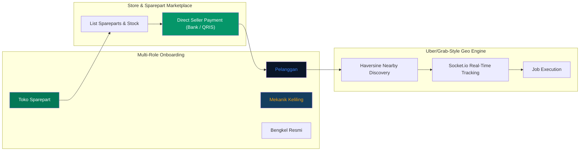

<!-- CAPSULE-RENDER HEADER -->


<!-- TYPING SVG -->
<div align="center">
  <a href="https://git.io/typing-svg">
    
  </a>
</div>

<br/>

<!-- BADGES -->
<div align="center">

[](https://vitejs.dev/)
[](https://react.dev/)
[](https://capacitorjs.com/)
[](https://expressjs.com/)
[](https://www.sqlite.org/)
[](./LICENSE)

</div>

---

## Overview

**Oke Mekanik (Masterpiece v28.2 ULTIMATE+)** is a production-grade, zero-mock full-stack ecosystem for mobile mechanics, workshops, and sparepart stores. Customers can request nearby mechanics, track real-time mechanic arrival (Uber/Grab style), diagnose vehicle issues via AI v7.0.1, and buy spareparts directly from local stores with seller-provided payment methods.

## Core Multi-Role Ecosystem

1. **Pelanggan (Customer)** — Request nearby mechanics, track route in real time, run AI diagnostics, and purchase spareparts from local stores.
2. **Mekanik Keliling (Mechanic)** — Independent mobile mechanics receiving job dispatches and tracking client routes.
3. **Bengkel Resmi (Workshop)** — Brick-and-mortar automotive service workshops managing teams of technicians.
4. **Toko Suku Cadang (Store / Sparepart Seller)** — List spareparts, set stock levels, and attach direct payment options (BCA, Mandiri, BRI, QRIS, GoPay).

## Visual Architecture

### Full Ecosystem & Marketplace Flow



## PWA & Mobile Readiness (Capacitor.js)

- **PWA Ready**: Web app manifest (`public/manifest.webmanifest`), theme configuration, and Service Worker caching (`public/sw.js`).
- **Capacitor.js Configured**: Native Android/iOS mobile deployment configuration (`capacitor.config.json`).

## Quick Start

### Prerequisites
- Node.js 22.x (LTS)
- npm or bun

### Installation & Database Initialization

```bash
git clone https://github.com/mulkymalikuldhrs/oke-mekanik-mobile-service.git
cd oke-mekanik-mobile-service
npm install --legacy-peer-deps
node server/db.js
```

### Running Development Server

```bash
npm run dev
```

### Production Build

```bash
npm run build
```

## License

**MIT License** — see [LICENSE](./LICENSE) for details.

## Author

**Mulky Malikul Dhaher**
- [GitHub](https://github.com/mulkymalikuldhrs)
- [Email](mailto:mulkymalikuldhr@mail.com)
