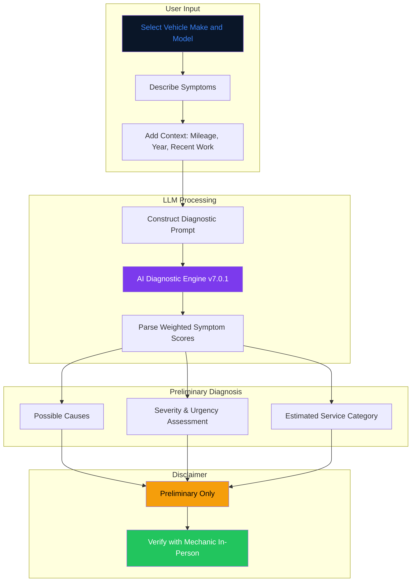
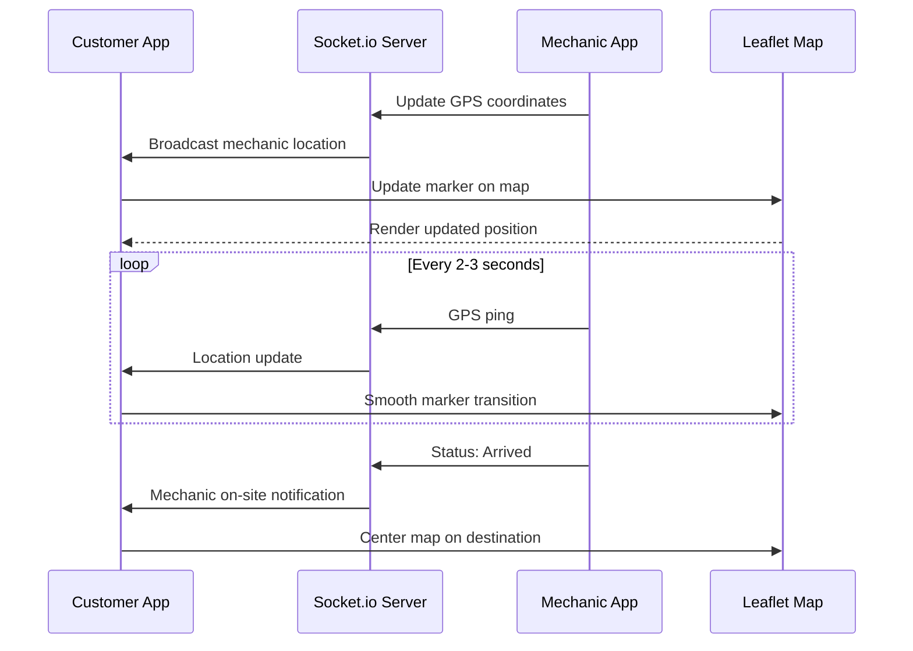
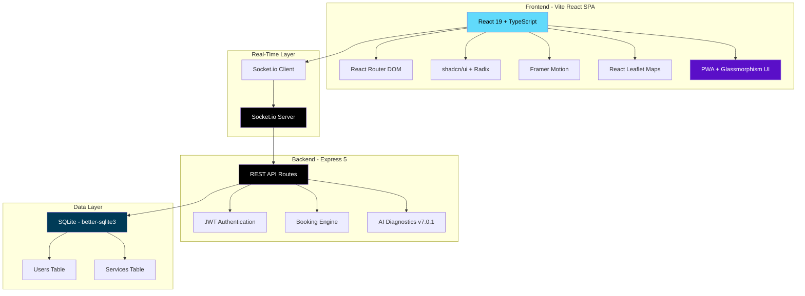

<!-- CAPSULE-RENDER HEADER -->


<!-- TYPING SVG -->
<div align="center">
  <a href="https://git.io/typing-svg">
    
  </a>
</div>

<br/>

<!-- BADGES -->
<div align="center">

[](https://react.dev/)
[](https://vite.dev/)
[](https://www.typescriptlang.org/)
[](https://expressjs.com/)
[](https://tailwindcss.com/)
[](./LICENSE)

</div>

---


<!-- AUTO-PACKAGE-BADGES:START -->
<!-- Auto-generated package badges -->

   [](https://www.npmjs.com/package/oke-mekanik-mobile-service)

<!-- AUTO-PACKAGE-BADGES:END -->

## Overview

**Oke Mekanik (v7.0.1 Masterpiece v28.2 ULTIMATE+)** is a futuristic mobile mechanic service platform built with React 19, Vite 8, and Express 5. Customers can book mechanics to come directly to their location, receive AI-powered preliminary vehicle diagnostics, track mechanic arrival in real-time, and manage service history — all from a high-fidelity glassmorphism web interface.

## Visual Architecture

### Service Booking Flow


### AI Diagnostics Pipeline



### Real-Time GPS Tracking



### Full Stack Architecture



> **Published**: This package is published as `oke-mekanik-mobile-service` v7.0.1. The AI diagnostics feature provides preliminary assessments only — always verify with an in-person mechanic inspection.

---

## Features

- **Service Booking** — Schedule mobile mechanic visits with location, vehicle info, and issue description
- **AI Preliminary Diagnostics v7.0.1** — Advanced symptom weighting and technical boost scoring (+55 points) including EV/Hybrid support and Overhaul detection
- **Real-Time Tracking** — Track your mechanic's arrival in real-time via Socket.io and Leaflet
- **Service History & Review System** — Complete record of past services with localized rating and review feedback
- **Mechanic Dashboard** — Real-time job management, navigation, and customer communication
- **Payment Integration** — In-app invoice tracking and instant status updates

## Quick Start

### Prerequisites
- Node.js 18+
- SQLite3 runtime

### Installation

```bash
git clone https://github.com/mulkymalikuldhrs/oke-mekanik-mobile-service.git
cd oke-mekanik-mobile-service
npm install --legacy-peer-deps
cp .env.example .env
```

### Running Development Server

```bash
npm run dev
```

### Running Backend Server Only

```bash
npm run backend
```

### Running Vitest Suite

```bash
npm test -- --run
```

## Project Structure

```
oke-mekanik-mobile-service/
├── server/               # Express 5 Modular Backend & SQLite DB
│   ├── controllers/      # Business logic controllers
│   ├── middleware/       # Auth & error handling middleware
│   ├── routes/           # REST API routes
│   └── db.js             # SQLite database schema & seeding
├── src/
│   ├── components/       # Reusable React components & UI primitives
│   ├── contexts/         # React Contexts (Auth)
│   ├── hooks/            # Custom hooks (useLanguage)
│   ├── lib/              # Centralized API gateway & utility functions
│   ├── pages/            # Application views (Customer, Mechanic, Admin)
│   └── types/            # TypeScript definitions
├── tests/                # E2E and verification scripts
└── public/               # Static PWA assets & manifest
```

---

## Contributing

1. Fork the repository
2. Create a feature branch
3. Submit a pull request

## Disclaimer

AI-generated diagnostics are preliminary suggestions only and should not be used as the sole basis for repair decisions. Always have a qualified mechanic perform an in-person inspection. The authors assume no liability for repair decisions made based on AI diagnostics.

## License

**MIT License** — see [LICENSE](./LICENSE) for details.

## Author

<div align="center">

**Mulky Malikul Dhaher**

[](https://github.com/mulkymalikuldhrs)
[](mailto:mulkymalikudhr@mail.com)

</div>

---

<!-- FOOTER BANNER -->

