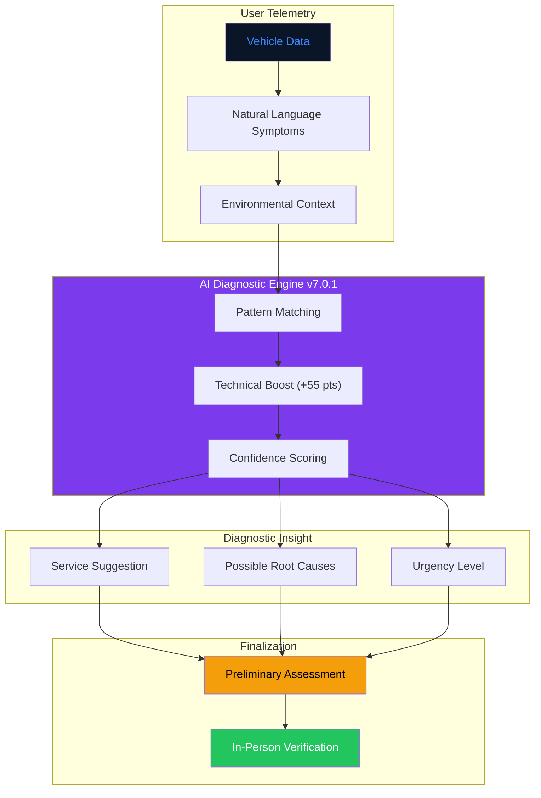
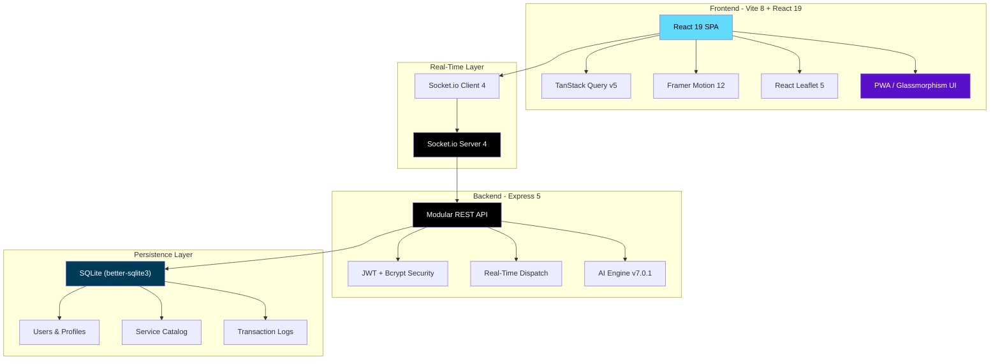

<!-- CAPSULE-RENDER HEADER -->


<!-- TYPING SVG -->
<div align="center">
  <a href="https://git.io/typing-svg">
    
  </a>
</div>

<br/>

<!-- BADGES -->
<div align="center">

[](https://vitejs.dev/)
[](https://react.dev/)
[](https://www.typescriptlang.org/)
[](https://expressjs.com/)
[](https://tailwindcss.com/)
[](./LICENSE)

</div>

---


<!-- AUTO-PACKAGE-BADGES:START -->
<!-- Auto-generated package badges -->

   [](https://www.npmjs.com/package/oke-mekanik-mobile-service)

<!-- AUTO-PACKAGE-BADGES:END -->

## Overview

**Oke Mekanik (Masterpiece v28.2 ULTIMATE+)** is a production-ready mobile mechanic platform built with React 19, Vite 8, and Express 5. Customers can book mechanics instantly, receive AI-powered vehicle diagnostics (v7.0.1), track mechanic arrival in real-time via GPS, and manage their automotive ecosystem from a futuristic glassmorphism interface.

## Visual Architecture

### Service Booking Flow

```mermaid
flowchart LR
    subgraph Request["Request"]
        A["Open App"] --> B["AI Diagnosis / Select Service"]
        B --> C["Set Location & Vehicle"]
        C --> D["Submit Booking"]
    end

    subgraph Match["Match"]
        D --> E["Auto-Dispatch System"]
        E --> F["Mechanic Accepts Job"]
        F --> G["ETA & Route Calculation"]
    end

    subgraph Track["Track"]
        G --> H["Real-Time GPS (Socket.io)"]
        H --> I["Mechanic En Route"]
        I --> J["Arrival Notification"]
    end

    subgraph Complete["Complete"]
        J --> K["Service Execution"]
        K --> L["Secure Payment"]
        L --> M["Review & Feedback"]
    end

    style A fill:#0a1628,color:#3b82f6
    style F fill:#143d5e,color:#f59e0b
    style H fill:#0d2b4a,color:#3b82f6
    style M fill:#22c55e,color:#fff
```



### AI Diagnostics Pipeline v7.0.1



### Full Stack Ecosystem



## Core Features (v7.0.1 ULTIMATE+)

- **AI Diagnostic Engine v7.0.1 ULTIMATE+** — Advanced pattern matching with specialized support for EV/Hybrid systems (`svc-13`) and Engine Overhaul (`svc-9`).
- **Real-Time GPS Ecosystem** — Instant mechanic tracking with smooth marker transitions and live ETA.
- **Zero-Mock Architecture** — Strictly persistent data flowing through Express 5 and SQLite.
- **Bilingual Interface** — Fully localized in Indonesian and English via `useLanguage`.
- **Modern Tech Stack** — Built with the latest React 19, Vite 8, and Framer Motion 12 for extreme performance.

## Quick Start

### Prerequisites
- Node.js 22.x (LTS)
- npm or bun

### Installation

```bash
git clone https://github.com/mulkymalikuldhrs/oke-mekanik-mobile-service.git
cd oke-mekanik-mobile-service
npm install --legacy-peer-deps
cp .env.example .env
```

### Running

```bash
npm run dev
```

## Project Structure

```
oke-mekanik/
├── src/
│   ├── pages/            # View components (Index, Dashboard, Booking)
│   ├── components/       # Reusable UI components
│   ├── contexts/         # Global state (Auth, etc.)
│   ├── hooks/            # Custom logic & Localization
│   ├── lib/              # API Gateway & Utilities
│   └── types/            # Centralized TypeScript definitions
├── server/
│   ├── controllers/      # Business Logic
│   ├── routes/           # API Endpoints
│   ├── middleware/       # Security & Error Handling
│   └── db.js             # Database Schema & Seeding
└── tests/                # Verification Suite
```

## Disclaimer

AI diagnostics are preliminary assessments only. Always verify with an in-person mechanic inspection. Oke Mekanik assumes no liability for decisions based solely on AI suggestions.

## License

**MIT License** — see [LICENSE](./LICENSE) for details.

## Author

**Mulky Malikul Dhaher**
- [GitHub](https://github.com/mulkymalikuldhrs)
- [Email](mailto:mulkymalikuldhr@mail.com)

---

<!-- FOOTER BANNER -->

